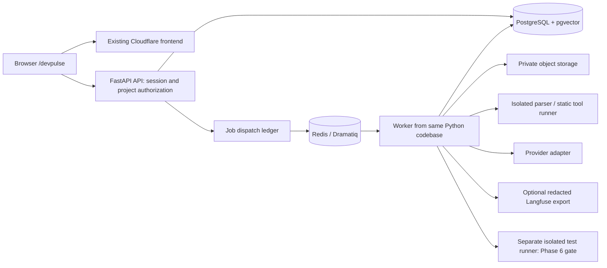

# DevPulse AI — architecture

Status: Phase 1 frontend plus Phase 2 backend/project UI code implemented. PostgreSQL, real worker, hosted OIDC and Docker verification remain blocked locally; see PROGRESS.md. Later ingestion/AI sections remain proposals.

## Implemented Phase 2 boundary

`services/devpulse/app` contains a FastAPI factory, versioned router, Pydantic DTOs/settings, synchronous SQLAlchemy sessions in synchronous thread-pool endpoints, OIDC adapter, owner-scoped project services and Dramatiq runtime. Alembic owns schema changes. Dedicated API/worker processes share one modular monolith. Request bodies, queries, retries, connection pools and diagnostics are bounded.

OIDC authorization code + PKCE S256 establishes a database-backed opaque HttpOnly session after signature/issuer/audience/expiry/nonce verification. The frontend gets identity and a CSRF token; provider access/refresh tokens are discarded. No development bypass exists. Public samples remain independent. Lazy `/devpulse/projects`, `/devpulse/projects/new`, `/devpulse/projects/:projectId` routes use API data and never fall back to samples. `components/live` separates session gate, forms, job history and request states from page composition.

Job rows double as a transactional dispatch ledger; no separate outbox table is needed for the single Phase 2 task. The dispatcher publishes IDs to Redis; actors claim/fence/retry against PostgreSQL. Cancellation/expired leases are explicit. Dramatiq supersedes proposed RQ per the Phase 2 brief. The only actor verifies infrastructure and produces no AnalysisRun or AI output.

Implemented details: [API.md](API.md), [DATABASE.md](DATABASE.md), [LOCAL_DEVELOPMENT.md](LOCAL_DEVELOPMENT.md), [DEPLOYMENT_PLAN.md](DEPLOYMENT_PLAN.md). The broader architecture below retains future context; cursor pagination, artifacts, analysis pipelines, vector tables, LLMs and traces are not Phase 2 capabilities.

## Implemented frontend boundary

`src/App.jsx` lazy mounts `DevPulseApp` only for `/devpulse/*`. It uses the existing BrowserRouter; nested routes load Landing, Workspace or Projects. Workspace lazily loads ArchitectureGraph (React Flow) and Inspector loads CodeViewer (Prism). Shared fixture data comes from a generated JSON snapshot, with strict TypeScript contracts. The separate Phase 2 API client serves authenticated projects only.

Server metadata is a narrow branch in existing Pages middleware using the same pure metadata function as the client. The SPA fallback, Vite base, Cloudflare settings, D1 schema, auth and other API handlers are unchanged. `.github/workflows/devpulse.yml` defines checks, not deployment. Actual account deployment mode remains an external unknown, so no live DevPulse release is claimed.

## Integration boundary

Keep the existing frontend at repository root. Add an integrated lazy feature, not a replacement frontend or a root-layout migration. Use a dedicated `/devpulse` exact-or-slash-prefix branch in App, analogous to existing `/3d`, with a self-contained shell and a portfolio-return link. No second BrowserRouter and no root basename change. DevPulse unknown paths must stay in its own NotFound.

The repository becomes a lightweight multi-runtime monorepo by adding one Python service directory. Do not add npm workspaces, Turborepo or move the portfolio into `apps/`: there is only one frontend, and moving it adds deployment risk without benefit.

```text
src/features/devpulse/       # TS routes, UI, scoped tokens, client, domain types
  components/ pages/ data/ api/ styles/
services/devpulse/          # independent Python package and lockfile
  app/api/ domain/ persistence/ ingestion/ analysis/ retrieval/ llm/ jobs/
  migrations/ tests/ prompts/ evaluations/
  pyproject.toml Dockerfile compose.yaml
docs/devpulse/              # persistent product and engineering decisions
```

Add files only in the phase that needs them. TypeScript strict/noEmit checks apply to new feature code; retain existing JS. Extend ESLint with compatible TS tooling without weakening old rules. Contract types generated from FastAPI OpenAPI in Phase 2; fixture schemas share those concepts but do not claim an API exists in Phase 1.

## Runtime topology



FastAPI + Pydantic, SQLAlchemy + Alembic, PostgreSQL as authoritative state. Phase 2 uses Redis/Dramatiq with an application-owned job ledger; see DATABASE.md for implemented dispatch, lease, retry and cancellation behavior and PROGRESS.md for pending real-infrastructure verification. API and worker are separate processes/images from one modular monolith, not independently designed microservices.

Phase 2 persists jobs with dispatch fields as its transactional outbox in the same row. Dispatcher sends job IDs, never untrusted serialized objects. Consumers claim leases, check deduplication keys and commit stage results transactionally. Redis delivery is treated as at-least-once; reconcile expired leases. Worker restart cannot mark incomplete work successful.

Private S3-compatible storage for immutable source snapshots and artifacts; local filesystem adapter for development. Dedicated bucket/credentials, never existing public portfolio media bucket. Download via authorized API or short-lived scoped signed URLs. Initial container hosting choice remains open until quotas, region, private networking, backups, worker lifecycle and sandbox capability are verified. No provider is provisioned by this plan.

Suggested API origin: `https://api.devpulse.alexgl.dev/api/v1` (proposed, not configured). Existing `/api/*` Functions remain untouched. Frontend uses `VITE_DEVPULSE_API_BASE_URL`, never existing portfolio API flags. Prefer direct API origin over a new edge proxy initially; explicit CORS for production/local/approved preview origins. [FastAPI CORS documentation](https://fastapi.tiangolo.com/tutorial/cors/) supports explicit origin configuration for credentialed requests. Do not allow all `*.pages.dev` previews to production credentials.

## Core data model

All private records have an authorization path to a project; composite foreign keys/queries must prevent cross-project association. UUID IDs, UTC timestamps, immutable snapshot IDs, migrations with indexes and uniqueness constraints. No database tables created in Phase 0.

| Entity | Important fields and relationships |
| --- | --- |
| User / Identity / Session | OIDC issuer+subject unique; server session hash, expiry/revocation; no custom password store |
| Project / Membership | owner, retention, state; unique (project,user), owner/editor/viewer role |
| Repository | project FK, canonical GitHub owner/name or upload identity, installation FK optional |
| Snapshot | repository FK, commit SHA for GitHub or archive SHA256, tree hash, source object, inventory policy; unique repository+content identity |
| SourceFile | snapshot FK, normalized relative path unique per snapshot, hash, language, bytes, line count, inclusion/exclusion reason |
| Symbol / Relationship | file FK, qualified name, kind, start/end lines; resolved or unresolved import/reference with parser version and evidence |
| AnalysisRun | project/snapshot FK, pipeline/config/toolset versions, status, coverage, parent run; immutable results per run |
| Job / StageAttempt / Outbox | run FK, idempotency key, lease, attempts, deadlines, cancel request, safe error code, artifact references |
| Finding / Evidence | run FK, stable fingerprint, origin=static/ai, tool+rule or prompt version, severity, confidence, category, verification state, exact file/range |
| Chunk / Embedding | snapshot/file/symbol, hash, range; optional vector, embedding model/version/dimension; access filtering before ranking |
| Conversation / Message / Citation | project+snapshot locked context, user/assistant, retrieval IDs, file/range hashes; history cannot silently switch snapshots |
| PatchProposal / PatchFile / Validation | snapshot and finding FKs, unified diff/hash, model/prompt, review state; separate validation kind/result/log reference |
| Execution / ToolInvocation | run/message/patch parent, provider/model, stage timing, usage nullable, cost type/rate version, correlation ID; private |
| PromptVersion / EvaluationDataset / EvaluationCase / EvaluationRun | content hashes, dataset split, expected evidence, pipeline/model/config versions, raw scores/denominators |
| GitHubInstallation / Approval / AuditEvent | installation/repository allowlist, approved action digest+actor+expiry, webhook delivery deduplication; no remote write by default |

Deletion tombstones block new work immediately, cancel jobs, revoke artifacts, then purge source, vectors, prompts and traces according to retention. Backup deletion lag must be documented. Avoid storing source blobs repeatedly in Postgres and observability.

## Initial API contract proposal

Prefix `/api/v1`. JSON errors use `{error:{code,message,request_id,retryable}}`; validation field details contain no secrets. Cursor pagination; page size max 100; per-project ownership checks on every ID. OpenAPI is authoritative once implemented. API docs and detailed readiness restricted in production.

| Method and path | Behavior / access |
| --- | --- |
| GET `/health/live`, `/health/ready` | Minimal health; detailed dependencies private |
| GET `/auth/login`, `/auth/callback`; POST `/auth/logout`; GET `/me` | OIDC/session lifecycle; CSRF for mutations |
| GET, POST `/projects`; GET, PATCH, DELETE `/projects/{id}` | Membership-scoped CRUD, deletion asynchronous |
| POST `/projects/{id}/imports` | Validated GitHub URL/ref; 202 job + Location; authenticated quota reservation |
| POST `/projects/{id}/analyses` | Snapshot and pipeline selection, 202; Idempotency-Key required |
| GET `/projects/{id}/runs`, `/runs/{runId}` | History, stages, coverage, exact snapshot |
| POST `/runs/{runId}/cancel` | Durable cancellation request, 202, no false immediate completion |
| GET `/runs/{runId}/events?after={cursor}` | Authorized resumable SSE; polling fallback |
| GET `/snapshots/{id}/files`, `/files/{fileId}?start_line=&end_line=` | Bounded source slices from snapshot, never arbitrary filesystem paths |
| GET `/snapshots/{id}/graph?focus=&depth=` | Bounded graph with evidence and unresolved edges |
| GET `/runs/{id}/findings`, `/findings/{id}` | Filters, evidence and provenance |
| POST `/projects/{id}/conversations`; POST `/conversations/{id}/messages` | Snapshot-bound question, 202 execution; source citations |
| POST `/findings/{id}/patches`; GET `/patches/{id}` | Bounded generation and diff |
| POST `/patches/{id}/validations`, `/patches/{id}/reviews`; GET `/patches/{id}/export` | Explicit validation/review, authorized download; no repository write |
| GET `/runs/{id}/traces`, `/evaluations`; POST `/evaluations/runs` | Project/operator permissions; evaluation execution operator-only |
| POST `/projects/{id}/uploads`; POST `/integrations/github/webhook` | Phase 8 only; bounded archives / verified deduplicated webhook |

Create responses 201, accepted jobs 202, invalid requests 422, unauthenticated 401, unauthorized resources preferably 404, conflicts/stale snapshot 409, quota 429 with Retry-After, unavailable dependency 503. Idempotency unique per actor+operation+key; payload hash mismatch returns 409, retries return original job. Never retry an external write automatically.

## Deterministic ingestion and analysis

Resolve allowlisted public GitHub owner/repo/ref to an immutable commit through trusted endpoints; download a bounded snapshot without credentials, submodule fetches, LFS expansion or Git hooks. Record upstream SHA and archive hash. Validate archive contents, enforce exclusions, detect secrets before provider use, inventory and hash files. Manifests parsed as data; no package install.

Tree-sitter adapters extract JS/TS/Python definitions/imports with positions; parser error nodes and unsupported syntax affect coverage. Cross-language and dynamic imports remain unresolved unless evidenced. Pin grammar/tool versions. Ruff, Semgrep and ESLint run in isolated tool jobs using trusted configuration only. Ignore repository ESLint configs/plugins, Ruff settings and Semgrep remote rules; no `npx` or pip installation from source. Syntax/type checks that require missing dependencies explicitly report incomplete. Pinned Semgrep rules and licensing reviewed before redistribution; [Semgrep rule execution](https://docs.semgrep.dev/running-rules) supports explicit rule selection.

Incremental analysis compares content hashes to parent snapshot. Reuse deterministic results only when file hash, tool/rules/config and dependency context match; invalidate affected graph neighborhood. Re-anchor all reused evidence to the new snapshot. Fall back to full analysis for uncertain dependencies. AI output caching additionally keys model, prompt, retrieval and policy versions.

## Workflow nodes and transitions

Single orchestrated workflow, not a collection of autonomous agents. Start with explicit typed Python state transitions; add LangGraph only in Phase 4 for checkpointed retrieval/answer and bounded repair branches. [LangGraph persistence](https://docs.langchain.com/oss/python/langgraph/persistence) supports checkpointing; our DB run ledger remains authoritative and side effects must be idempotent.

```text
queued → validating → fetching → inventory → parsing → static_analysis
       → indexing → [ai_interpretation when enabled] → publishing → completed
any active stage → cancel_requested → cancelled
transient failure → retry_wait → same stage (new attempt)
terminal failure → failed
publishing → partial (usable artifacts plus explicit tool failures)
```

| Node | Input → output | Reason for existence |
| --- | --- | --- |
| authorize/reserve | identity+project+request → quota reservation/job | reject unauthorized spend before work |
| validate/fetch | repository locator → immutable bounded snapshot | establish reproducible input |
| inventory/redact | archive → safe inventory/exclusion/secret markers | enforce content boundary |
| parse/link | files → symbols and evidenced edges | deterministic structure |
| static tools/normalize | source+trusted rules → observations | observed findings, no LLM needed |
| index | eligible symbols/docs → lexical and optional semantic indexes | bounded evidence retrieval |
| retrieve | question+snapshot → ranked source spans | exact symbols and lexical first, graph neighbors, vector candidates when useful |
| answer/interpret | evidence+versioned prompt → Pydantic result | explain grounded context / separate AI assessments |
| verify | output+snapshot → validated citations or abstention | reject invented paths, lines and unsupported structure |
| patch/validate | approved generation request+source → diff and independent results | human-reviewable changes, no automatic application |
| publish | validated artifacts → immutable result and coverage | never publish incomplete output as successful |

Persist state includes snapshot ID, pipeline version, node/attempt, artifact hashes, policy version, budget counters, cancellation flag and safe errors. No raw source in queue payloads. Cancellation checked between stages and enforced through runner termination; final status only after child processes stop. Heartbeat/lease recovery and race tests required.

Initial configurable policy proposals: import deadline 120 s, tool 60 s, model call 45 s, analysis wall time 10 min; at most 2 transient retries with exponential jitter and Retry-After support. Authorization, archive violations and invalid inputs never retry. One schema-repair attempt maximum; then fail/abstain. Provider request timeout may still incur charges: record unknown usage, do not claim exactly-once provider billing.

Retrieval uses project/snapshot filters before candidate selection, exact path/symbol matching, PostgreSQL lexical ranking, bounded structural neighbors and optional pgvector for selected symbols/docs. Fuse/deduplicate spans, preserve line numbers, cap evidence initially to 12 spans / 12k tokens. Reserve output budget; truncate context explicitly, never silently invent coverage. Skip binary/generated/vendor/minified/secret content. Embedding benchmark must beat lexical baseline before default enablement.

Provider adapter accepts purpose, model policy, budget and validated input; returns structured data, provider/model, usage if reported, timing, finish reason. Mock adapters are test-only. Do not fallback to simulated success. Fallback provider requires equivalent privacy approval and budget policy. Credentials are server-side deployment secrets initially; user-supplied keys deferred.

Langfuse is suitable as an optional trace export after privacy/region review, not a source of operational truth or a required ingestion dependency. [Masking support](https://langfuse.com/docs/observability/features/masking) helps redact exported data; default export is metadata-only with no source, prompts, answers or secrets. SDK behavior, retention and masking tests must pass before enabling it.
