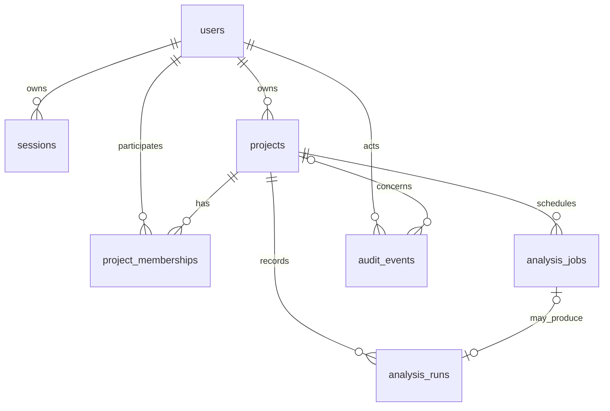

# DevPulse database — Phase 2

PostgreSQL only, SQLAlchemy 2.0 + psycopg 3. Alembic revision `0001` executes a frozen SQL migration, independent of later ORM changes. API startup never calls create_all. UUID identifiers and timezone-aware UTC timestamps; Python ORM defaults are intentional and direct SQL writers must supply required values. Migration initializes `vector` without creating embeddings or choosing a dimension.

| Table | Purpose and constraints |
| --- | --- |
| `users` | UUID; unique issuer+subject identity; display name, optional verified email, active/disabled status, timestamps |
| `sessions` | SHA-256 token hash PK, user FK, CSRF hash, indexed expiry; opaque cookie value never stored |
| `login_attempts` | State hash PK, browser binding hash, one-use PKCE verifier/nonce, indexed five-minute expiry |
| `projects` | Owner FK, name/description/source reference, private-only visibility, timestamps and deletion tombstone; composite owner/created/id index |
| `project_memberships` | Composite project/user PK and role constraint owner/editor/viewer; Phase 2 creates owner only, no team/invitation API |
| `analysis_jobs` | Project FK, diagnostic-only type, constrained states/progress/attempts, project+idempotency key unique, lifecycle timestamps/cancel/lease/dispatch fields |
| `analysis_runs` | Future completed analysis storage; project FK, optional unique job FK, revision, pipeline, start/end, status and JSONB details; deliberately empty in Phase 2 |
| `audit_events` | Actor/project FKs, allowlisted application operation name, request UUID, timestamp; no project descriptions, source, IPs or provider tokens |

Authorization queries always require owner ID from a validated session and `deleted_at IS NULL`. Membership roles are schema preparation, not a second partially implemented authorization policy. Live records have no public-read mode. Job IDs are checked together with their authorized project ID.

Create/update/delete/job mutations commit business state and audit events together. Project mutation row locks serialize deletion and job submission; job row locks protect claims, completion and cancellation. Sync SQLAlchemy sessions run only in FastAPI synchronous endpoints/dependencies (thread pool), never in async route handlers. Each request closes its session; workers create independent transactional sessions. Pool size 5, overflow 5, checkout/connect/statement timeouts 5 seconds.

## Job dispatch ledger

The `analysis_jobs` row also acts as a transactional outbox. API commit creates durable queued state, then a worker dispatcher scans up to 50 due rows every two seconds with SKIP LOCKED and publishes only UUIDs. It advances the next-delivery timestamp only in the same locked transaction. A crash between Redis publish and commit may duplicate delivery; it cannot cause a silently completed job.

An actor claims queued state, increments attempt count, assigns a random fencing token and a 30-second lease. It checks Redis and pgvector, commits progress, then finishes only if it still owns the lease. Cancellation invalidates the token. Dispatcher recovers expired leases; at most three processing attempts, exponential 2^attempt seconds delay. Queued jobs older than five minutes fail when the dispatcher is operating. Redis/process downtime can delay that transition; the API never fabricates worker progress. Dramatiq's automatic retries are disabled because the database controls retries. Actor time limit 10 seconds is a soft thread interrupt; database/network timeouts bound blocking calls. This is suitable for diagnostics, **not a source-code sandbox**.

Cancellation immediately fences the bounded diagnostic, but cannot interrupt an already issued network/database call. Terminal states never restart. Diagnostic results do not write AnalysisRuns or findings. Worker heartbeat TTL is 15 seconds; readiness also verifies migration and extension. Graceful shutdown stops polling and gives workers 15 seconds; hard failure is recovered through leases.

## Retention and migration policy

Soft deletion immediately denies access and cancels active jobs. Tombstones/audit events remain; physical purge, retention scheduler and account erasure are not implemented. Expired login attempts/sessions are removed during subsequent login/session issuance. A periodic maintenance/purge policy is a production prerequisite.

Downgrade `0001` removes tables in reverse FK order. It intentionally retains pgvector because an extension could be shared. Never downgrade production automatically. Use a separate migration role and pre-enable pgvector if application credentials lack extension permission.

Future embedding migration must first select a model/version/dimension and demonstrate retrieval benefit. Then add snapshot-authorized chunk metadata and a vector table/index with model/dimension checks; backfill with explicit provenance and quotas. Do not encode a guessed dimension now. Future AnalysisRun creation must also enforce matching project/job association in a migration/service before it is exposed; no run-writing endpoint exists today.
